=================================
Contents of My Paper
=================================

| 
| Last Update: |today|
| 
| 

.. contents::
   :backlinks: none

| 

------------------------------------------------------------------------------------------------------

| 

**Habit formation, equilibrium yield curve, and interest rate lower bound**
--------------------------------------------------------------------------------
| Author(s): Kohei Hasui
| **Work in progress** (Aug 2022).
| Presented at a joint APIR/JCER seminar on Sep 9, 2022.

| **Abstract:**
| This study investigates the impact of habit formation on the equilibrium yield curve in a New Keynesian model incorporating recursive preferences and a zero lower bound on the nominal interest rate. We compare the impact of habit formation in two monetary policy schemes: the Taylor rule and optimal discretionary policy. Numerical results show that habit persistence significantly amplifies the effect of zero interest rates on equilibrium yield and term premium under optimal discretionary policy, but not under the Taylor rule.

| **The model**
| Structural equations:

.. math::

  &M_{t,t+1}
    =
    \beta _t 
    \left[
        \frac{U_c(X_{t+1},N_{t+1})}{U_c(X_t,N_t)}
    \right]
    \left[
        \frac{V_{t+1}}{\left\{\mathbb{E}_tV_{t+1}^{1-\alpha}\right\}^{\frac{1}{1-\alpha}}}
    \right]^{-\alpha}\frac{1}{\Pi_{t+1}},\\
  &\mathbb{E}_t\left[M_{t,t+1}R_t\right]=1,\\
  &Y_t
    =
    \theta \omega_t X_t
    +
    \varphi
    \left(\frac{\Pi_t}{\Pi}-1\right)
        \frac{\Pi_t}{\Pi}Y_t
        -\mathbb{E}_t
    \left[
        \varphi M_{t,t+1} \Pi_{t+1}Y_{t+1}
        \left(\frac{\Pi_{t+1}}{\Pi}-1\right)
        \frac{\Pi_{t+1}}{\Pi}
    \right], \\
   &\omega_t
    =
    \left(1-\frac{w_t}{A_t}\right) + \eta \mathbb{E}_t
    \left[
    M_{t,t+1}\Pi_{t+1}\omega_{t+1}
    \right],\\
  &\beta_t = \beta \delta_t.

| Optimal discretionary policy:

.. math::

    V(S_t)
    =
    \max_{\{z_t\}}
    \left[
        \frac{X_t^{1-\chi_c}}{1-\chi_c}
        -
        \varkappa_n \frac{N_t^{1+\chi_n}}{1+\chi_n}
    \right]
    + \beta_t \mathbb{E}_t
    \left[
        V(S_{t+1})^{1-\alpha}
    \right]^{\frac{1}{1-\alpha}},

| where  :math:`S_t \equiv [\,\delta_t,\ A_t,\ C_{t-1}\, ]` denotes state variables, and  :math:`z_t \equiv (\,V_t,C_t,N_t,Y_t,\Pi_t,R_t,w_t,\omega_t\,)` .

| Taylor Rule:

.. math::

    R_t
    = 
    \max
    \left[
    R_{ZLB}, \frac{\Pi}{\beta }\left(\frac{\Pi_t}{\Pi}\right)^{\phi_{\pi}}
    \right].

|
| **Main figures:** 

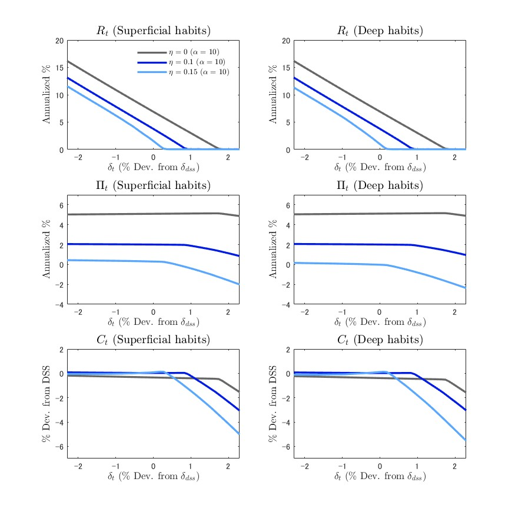

   **Figure:** Policy functions for degree of habit persistence :math:`\eta` under optimal discretionary policy.

|

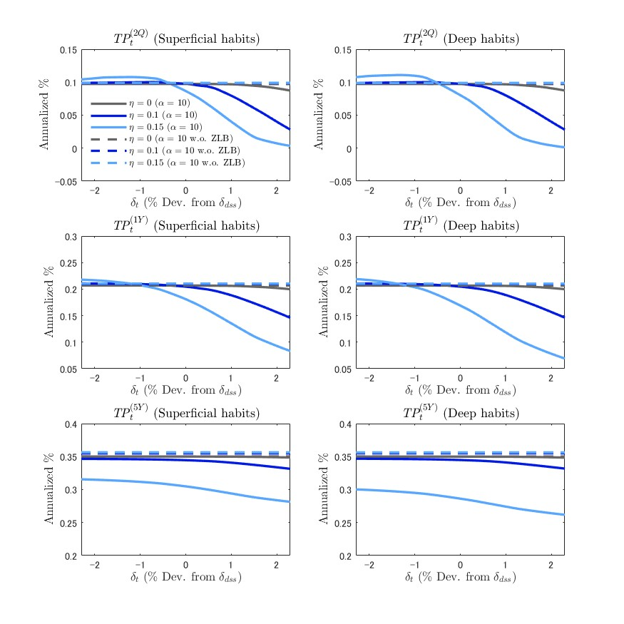

   **Figure:** Policy functions of term premiums for degree of habit persistence :math:`\eta` under optimal discretionary policy.

|

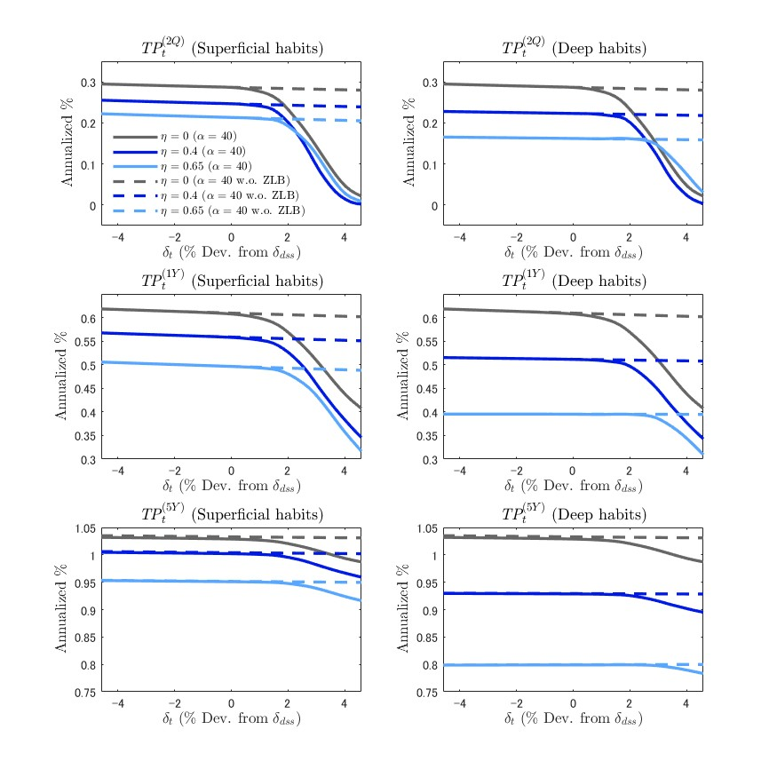

   **Figure:** Policy functions of term premiums for degree of habit persistence :math:`\eta` under the Taylor rule.

------------------------------------------------------------------------------------------------------

| 

**Optimal irreversible monetary policy** [#hksdisc]_
--------------------------------------------------------------------------------
| Author(s): Kohei Hasui, Teruyoshi Kobayashi, and Tomohiro Sugo
| *European Economic Review* 134, 103707, May 2021.

.. only:: html or singlehtml

   .. raw:: html

       

       <ul class="simple">
       <li>
<a target="_blank" href="https://doi.org/10.1016/j.euroecorev.2021.103707">Publisher's Page </a>
</li>
       <li>
<a target="_blank" href="https://papers.ssrn.com/sol3/papers.cfm?abstract_id=3793318">PDF (SSRN) </a>
</li>
       <li>
<a target="_blank" href="https://github.com/KHasui/Codes-for-optimal-irreversible-monetary-policy">Matlab codes </a>
</li>
       </ul>

 
Real-world central banks have a strong aversion to policy reversals. Nevertheless, theoretical models of monetary policy within the dynamic general equilibrium framework normally ignore the irreversibility of interest rate control. In this paper, we develop a formal model that incorporates a central bankÅfs discretionary optimization problem with an aversion to policy reversals. We show that, even under a discretionary regime, the optimal timing of liftoff from the zero lower bound is characterized by its history dependence, which arises from the option value to waiting, and there exists an optimal degree of policy irreversibility at which the social loss is minimized.

| **The model:**

.. math::

  x_t&= \mathbb{E}_t x_{t+1}-\sigma (i_t-\mathbb{E}_t \pi_{t+1}-r_t^n),\label{eq:is}\\
  \pi _t&= \beta \mathbb{E}_t\pi_{t+1}+\kappa x_t,\label{eq:pc}\\
  r^n_t &= \rho_{r}r^n_{t-1} + \epsilon_t, \label{eq:rshock}\\
  i_t &\geq 0. \label{eq:ZLBconst}

| **Central bank with policy reversal aversion:**

.. math::

   L_t = \pi_t^2 + \lambda_x x_t^2 + \lambda_{\text{ir}} F(\delta_{t-1},\Delta i_t), 

| where :math:`F(\delta_{t-1},\Delta i_t)` is given by

.. math::

        F(\delta_{t-1},\Delta i_t) = \frac{\delta_{t-1}(1+\delta _{t-1})}{2}\times[\min(\Delta i_t,0)]^2 - \frac{\delta_{t-1}(1-\delta _{t-1})}{2}\times[\max(\Delta i_t,0)]^2.

|
| 

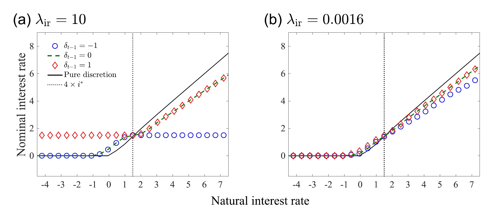

   **Fig. 4**: Policy function for interest rate.

| 

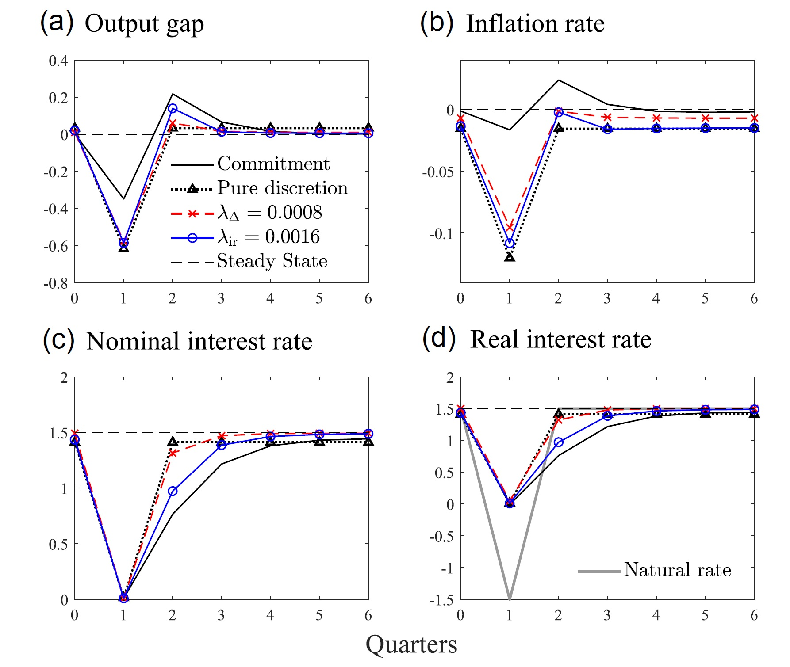

   **Fig. 5**: Impulse responses to a temporal :math:`-3\%` natural rate shock. 

| 

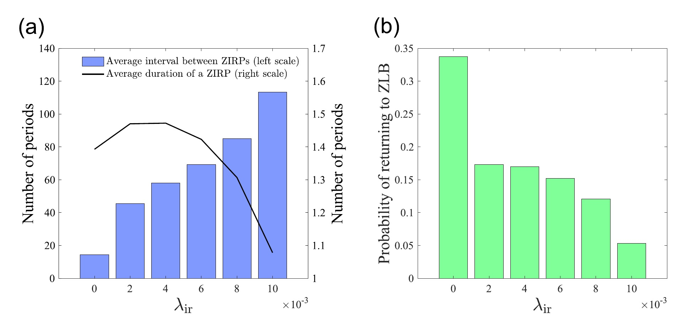

   **Fig. 10**: Frequency of zero interest rate policies (ZIRPs).

| 

.. rubric:: Notes

.. [#hksdisc] The views expressed here are those of the authors and do not necessarily reflect the official views of the institutions to which the authors belong.

------------------------------------------------------------------------------------------------------

| 

**How robustness can change the desirability of speed limit policy** [#ftitle]_
--------------------------------------------------------------------------------
| Author(s): Kohei Hasui
| *Scottish Journal of Political Economy* 68(5), 553-570, 2021.

.. only:: html or singlehtml

   .. raw:: html

       

       <ul class="simple">
       <li>
<a target="_blank" href="https://doi.org/10.1111/sjpe.12268">Publisher's Page </a>
</li>
       <li>
<a target="_blank" href="https://www.researchgate.net/publication/346952243_How_robustness_can_change_the_desirability_of_speed_limit_policy">PDF (RG) </a>
</li>
       </ul>

 
This paper investigates a robust monetary policy under speed limit policy when a central bank fears model misspecification. We show that the persistence of the output gap becomes small with the robust speed limit policy. The low persistence of the output gap contributes to mitigating the variance of the output gap. Also, with a robust policy, social losses are lower under the speed limit policy than under precommitment. Our results suggest that adding the growth of the output gap to the central bankÅfs objectives is effective when the worst-case scenario is realized.

| **The model (Walsh, 2003)**
| *Robust control problem:*

.. math::

   &\max_{\nu_t} \min _{\pi_t, x_t} \mathbb{E}_t \sum_{j = 0}^{\infty} \beta ^j (\pi_{t+j}^2 + \lambda (x_{t+j}-x_{t+j-1})^2 + \delta \nu_{t+j}^2)
   \\
   &\text{s.t.}
   \\
   &\pi_t = \beta \mathbb{E}_t\pi_{t+1} + \kappa x_t + (e_t + \nu_t).

| 
| 

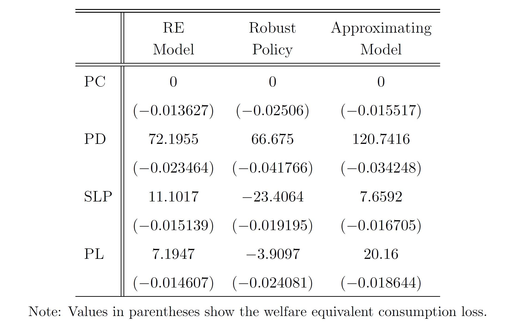

   **Table 1**: Comparison of percentage welfare loss relative to precommitment and welfare equivalent consumption loss.

|
| **Analyses in an extended model:**

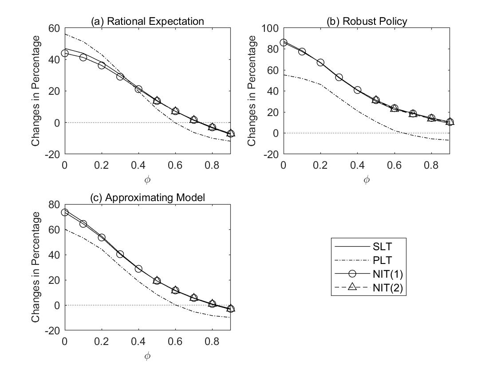

   **Fig. 1**: Relative gains to inflation targeting for degrees of :math:`\phi`. [#f0]_ [#f01]_ 

.. rubric:: Notes

.. [#ftitle] Previous title: "Speed limit policy and Knightian uncertainty."
.. [#f0] :math:`\phi` denotes degree of inflation persistence.
.. [#f01] SLT, PLT, and NIT denote speed limit targeting regime, price-level targeting regime, and nominal income targeting regime, respectively.

| 

------------------------------------------------------------------------------------------------------

| 

**Trend growth and robust monetary policy**
-----------------------------------------------------------------------
| Author(s): Kohei Hasui
| *The B.E. Journal of Macroeconomics* (Contributions) 21(2), 449-472, 2021.

.. only:: html or singlehtml

   .. raw:: html

       

       <ul class="simple">
       <li>
<a target="_blank" href="https://doi.org/10.1515/bejm-2020-0133">Publisher's Page </a>
</li>
       <li>
<a target="_blank" href="https://www.researchgate.net/publication/345135731_Trend_growth_and_robust_monetary_policy">PDF (RG) </a>
</li>
       </ul>

| 
| Recent monetary policy studies have shown that the trend productivity growth has non-trivial implications for monetary policy. This paper investigates how trend growth alters the effect of model uncertainty on macroeconomic fluctuations by introducing a robust control problem. We show that an increase in trend growth reduces the effect of the central bank's model uncertainty and, hence, mitigates the large macroeconomic fluctuations. Moreover, the increase in trend growth contributes to bringing the economy into determinacy regions even if larger model uncertainty exists. These results indicate that trend growth contributes to stabilizing the economy in terms of both variance and determinacy when model uncertainty exists.
| 
| **The model (Mattesini and Nistico, 2010)**
| *The robust control problem:* [#f1]_

.. math::

   &\min_{\pi_t,x_t,i_t} \max_{\nu_t} \ \mathbb{E}_t\sum_{j = 0}^{\infty} (\beta \gamma^{1-\sigma})^j[L_{t+j} - \theta \nu_{t+j}'\nu_{t+j}]
    \\
    &\text{s.t.}
    \\
    &x_t = \mathbb{E}_tx_{t+1} - \sigma^{-1}_n[i_t - \mathbb{E}_t \pi_{t+1} - (r_t^n + \nu_{t}^r)]
    ,
    \\
    &\pi_t = \beta \gamma^{1-\sigma}\mathbb{E}_t \pi_{t+1} + \kappa(\gamma) \xi x_t + (u_t + \nu_t^u),

| where

.. math::

   L_t = \frac{\epsilon }{\kappa(\gamma)}\pi_t^2 + \xi x_t^2.

| **Proposition 2.** *In the worst-case scenario, a higher trend growth decreases the effect of the central bank's model uncertainty on the inflation rate, the output gap, and the policy rate under Assumptions 1 and 2.*
| 
| *Proof.*  [...] Combining these conditions, we determine the signs of the cross-derivative as follows: [#fc]_

.. math::
        &-\frac{\partial^2 |c_{\pi}(\theta,\gamma)|}{\partial \theta \partial \gamma}
        <0,
        \
        -\frac{\partial^2 |c_x(\theta,\gamma)|}{\partial \theta \partial \gamma}
        <0
        ,
        \
        \text{and }
        -\frac{\partial^2 |c_i(\theta,\gamma)|}{\partial \theta \partial \gamma}
        <0
        \text{ if }
        \sigma > 1
        .
        \label{eq:result2a}
        \\
        &-\frac{\partial^2 |c_{\pi}(\theta,\gamma)|}{\partial \theta \partial \gamma}
        >0,
        \
        -\frac{\partial^2 |c_x(\theta,\gamma)|}{\partial \theta \partial \gamma}
        >0
        ,
        \
        \text{and }
        -\frac{\partial^2 |c_i(\theta,\gamma)|}{\partial \theta \partial \gamma}
        >0
        \text{ if }
        \sigma < 1
        .
        \label{eq:result2b}

| Since :math:`\sigma >1`, the signs of inequalities are negative. Therefore, a higher trend growth decreases the effect of the central bank's model uncertainty on the inflation rate, the output gap, and the policy rate. QED.

| 
| 

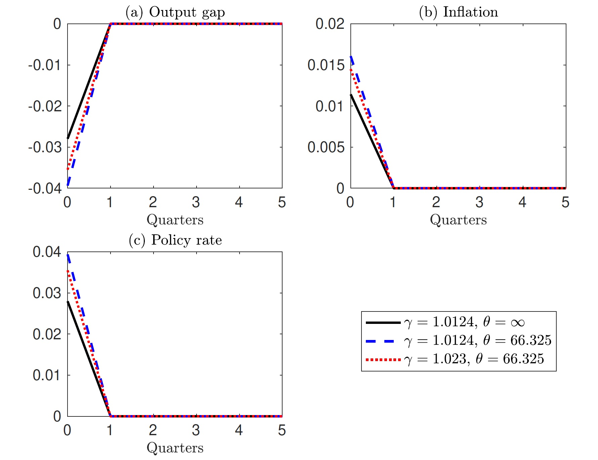
   
   **Fig. 1**: Impulse response to 1% cost-push shock under discretion.

| 
| 

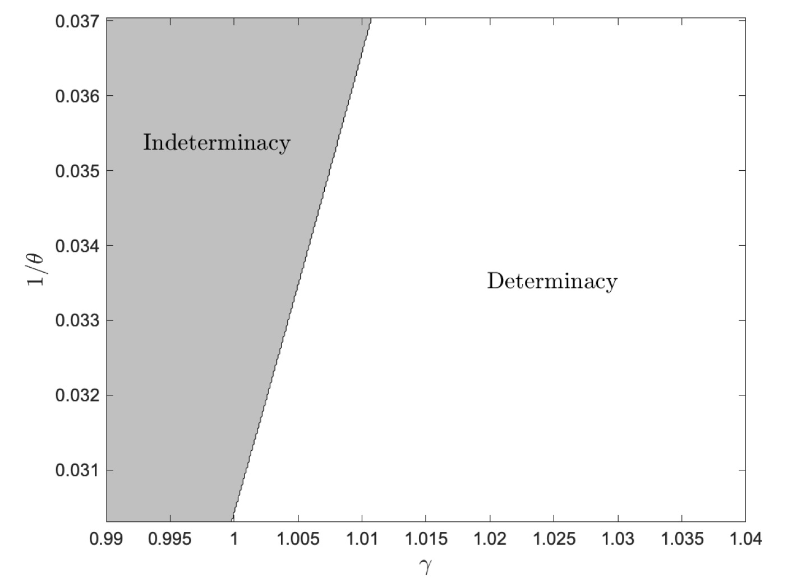
   
   **Fig. 2**: Determinate and indeterminate area (:math:`\sigma = 5`, :math:`\gamma = 1.0124`, :math:`\beta= 0.99`, :math:`s_c = 0.8^{-1}`, :math:`\zeta = 13`, :math:`\alpha = 0.7`, :math:`\varphi = 0.5` and :math:`\epsilon = 9.8`)

.. rubric:: Notes

.. [#f1] :math:`\gamma` denotes trend growth.
.. [#fc] :math:`c_j` for :math:`j = \pi, x, i` denotes a coefficient of policy function in response to the cost-push shock.

| 

------------------------------------------------------------------------------------------------------

| 

**A note on robust monetary policy and non-zero trend inflation** [#f2]_
-------------------------------------------------------------------------------
| Author(s): Kohei Hasui
| *Macroeconomic Dynamics* 24(6), 1574-1594, 2020.

.. only:: html or singlehtml

   .. raw:: html

       

       <ul class="simple">
       <li>
<a target="_blank" href="https://doi.org/10.1017/S1365100518000883">Publisher's Page </a>
</li>
       <li>
<a target="_blank" href="https://www.researchgate.net/publication/328916556_A_note_on_robust_monetary_policy_and_non-zero_trend_Inflation">PDF (RG) </a>
</li>
       </ul>

| 
| This paper studies how model uncertainty influences economic fluctuation when trend inflation is high. We introduce Hansen and SargentÅfs [(2008) *Robustness*, Princeton University Press] robust control techniques into a New Keynesian model with non-zero trend inflation. We reveal the following three points. First, we find that robust monetary policy responds more aggressively. This aggressiveness increases with trend inflation. Second, as the trend inflation rises, the response of macroeconomic variables is larger under robust policy. Third, stronger robustness tends to lead to indeterminate equilibrium as trend inflation increases. Consequently, the economy might be volatile when trend inflation is high due to robustness from the view of both variance and determinacy. We interpret the results as indicating that the model uncertainty might be the one of the factors causing large macroeconomic fluctuations when trend inflation is high.
| 
| **The model (Sbordone, 2007, Cogley and Sbordone, 2008, and Alves, 2012 and 2014)**
| *Robust control problem:*

.. math::

    &\min_{x_t,\pi_t,i_t}\max_{v_{t}}\mathbb{E}_t\sum _{j=0}^{\infty}
    \beta ^j[
    L_{t+j} - \theta v_{t+j}'v_{t+j}]
    \\
    &\text{s.t}
    \\
    &x_t = \mathbb{E}_tx_{t+1} - \sigma [i_t - \mathbb{E}_t\pi_{t+1}-(r_t^n + v^x_t)]
    \\
    &\pi_t
    =
    \mathcal{K}(\Pi)x_t
    +
    \mathcal{B}(\Pi)\mathbb{E}_t\pi_{t+1}
    + h_t
    + \gamma(\Pi)(r_t^n+v_t^x) + (u_t + v^{\pi}_{t})
    \\
    &h_t = \beta \chi (\Pi)\mathbb{E}_tx_{t} + \beta \zeta (\Pi)\mathbb{E}_t\pi_{t+1}
    +
    \phi \mathbb{E}_t h_{t+1} + v_{t}^h,

where

.. math::
    L_t
    =
    \pi_t^2
    +
    \lambda (\Pi)x_t^2,\ \ 
    \lambda (\Pi)
    =
    \frac
    {1-\bar{\alpha}}
    {1-\bar{\alpha}\vartheta}
    \frac{\kappa(\Pi)}
    {\epsilon}.

|
|
| **Proposition 1.** *In the worst-case scenario, Eqs. (11) - (16) show that stronger policy robustness increases sensitivity in inflation, output gap, and policy rate in response to cost-push shock and natural rate shock under Assumption 2.*
|
| **Proposition 2.** *In the worst-case scenario, Eqs. (18) - (21) show that the amount of change in sensitivity in inflation, output gap, and policy rate depend on trend inflation.*

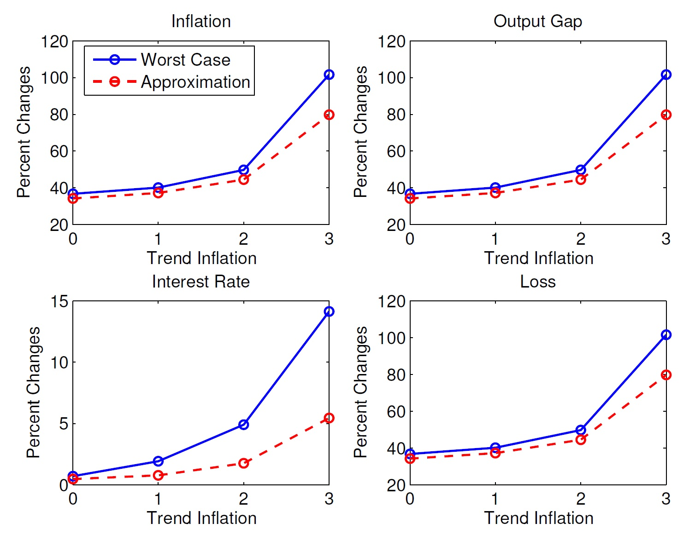

   **Fig. 1**: Percent changes in variances and losses.

|

.. rubric:: Notes

.. [#f2] This work is inspired by Kobayashi, T., and Muto, I. (2013) `"A note on expectational stability under non-zero trend inflation," <https://doi.org/10.1017/S1365100511000411>`_ *Macroeconomic Dynamics* 17(3), 681-693.

| 

------------------------------------------------------------------------------------------------------

| 

**Role of expectations in a liquidity trap** [#fjjie]_
-----------------------------------------------------------------------
| Author(s): Kohei Hasui, Yoshiyuki Nakazono,  and Yuki Teranishi
| *Journal of the Japanese and International Economies* 52, 201-2015, 2019.

.. only:: html or singlehtml

   .. raw:: html

       

       <ul class="simple">
       <li>
<a target="_blank" href="https://doi.org/10.1016/j.jjie.2018.12.004">Publisher's Page </a>
</li>
       <li>
<a target="_blank" href="https://www.researchgate.net/publication/329860565_Role_of_expectations_in_a_liquidity_trap">PDF (RG) </a>
</li>
       </ul>

| 
| A number of previous studies suggest that inflation expectations are important in considering the effectiveness of monetary policy in a liquidity trap. However, the role of inflation expectations can be very different, depending on the type of monetary policy that a central bank implements. This paper reveals how a private agent forms inflation expectation affects the effectiveness of monetary policy under the optimal commitment policy, the Taylor rule, and a simple rule with price-level targeting. We examine two expectation formations: (i) different degrees of anchoring, and (ii) different degrees of forward-lookingness. We show that how to form inflation expectations is less relevant when a central bank implements the optimal commitment policy, while it is critical when the central bank adopts the Taylor rule or a simple rule with price-level targeting. Even for the Japanese economy, the effects of monetary policy on economic dynamics significantly change according to expectation formations under rules other than the optimal commitment policy.

|
| **The model:**

.. math::
    x_t =&\, x_{t+1}^e - \sigma (i_t -\pi_{t+1}^e- r_t^n),
    \\
    \pi_t =&\, \beta \pi_{t+1}^e + \kappa x_t,\label{eq:nkpc}
    \\
    r_t^n =&\, \rho_r r^n_{t-1} + \epsilon_t,\label{eq:ar}
    \\
    i_t \geq &\, 0.

| where

.. math::
    \pi_{t+1}^e := 
    \begin{cases}
    \ \gamma_{\pi} \text{E}_t\pi_{t+1} + (1-\gamma_{\pi})\bar{\pi}, & \ \ \ \ \ \ \ \ \ \ \ \ \ \ \ \ \textrm{(a)}
    \\
    \ \gamma_{\pi} \text{E}_t\pi_{t+1} + (1-\gamma_{\pi})\pi_t, & \ \ \ \ \ \ \ \ \ \ \ \ \ \    \ \  \textrm{(b)}
    \end{cases}

| Optimal commitment policy:

.. math::
    &\pi _{t} -\beta ^{-1}\sigma \gamma_{\pi}\phi _{1t-1} + \phi _{2t}-\gamma_{\pi}\phi _{2t-1}=0,\label{FOC1ae}
    \\
    &\lambda _{x}x_{t}+\phi _{1t}-\beta ^{-1}\phi _{1t-1}-\kappa \phi _{2t}=0,\label{FOC2ae}
    \\
    &i_{t}\phi _{1t}=0,\ \phi _{1t}\geq 0,\  i_{t}\geq 0.\label{KT1ae}

| 

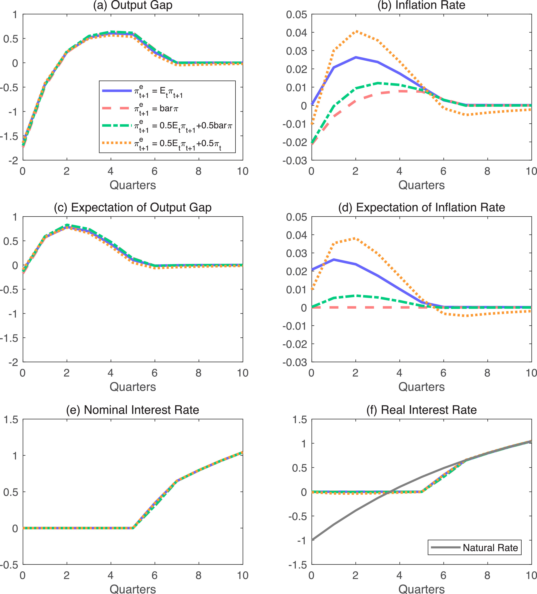

   **Fig. 3**:  Impulse responses to an annual :math:`3\%` natural rate shock under optimal commitment policy for different expectation formations for an inflation rate. Note: the scale of the figure is ÅesmallÅf.

.. rubric:: Notes

.. [#fjjie] Published in *Special Section on Unconventional Monetary Policy in Japan.*

| 

------------------------------------------------------------------------------------------------------

| 

**The liquidity effect and tightening effect of the zero lower bound**
-----------------------------------------------------------------------
| Author(s): Kohei Hasui
| *Japanese Journal of Monetary and Financial Economics* 2(2), 1-15, 2014.

.. only:: html or singlehtml

   .. raw:: html

       

       <ul class="simple">
       <li>
<a target="_blank" href="https://doi.org/10.32184/jjmfe.2.2_1">Publisher's Page </a>
</li>
       <li>
<a target="_blank" href="https://www.researchgate.net/publication/340916855_The_liquidity_effect_and_tightening_effect_of_the_zero_lower_bound">PDF (RG) </a>
</li>
       </ul>

| 
| The tightening effect of the zero lower bound on the nominal interest rate is a non-trivial topic in monetary policy: at the zero lower bound, responding to a rise in money growth by reducing the nominal interest rate?what is called the liquidity effect?is not possible because the nominal interest rate cannot be further decreased. However, the absence of the liquidity effect caused by the zero lower bound might amplify the tightening effect of the zero lower bound. I call this tightening effect of the zero lower bound through its liquidity effect on the economy the rebound of liquidity effect, and demonstrate it quantitatively with a simple dynamic stochastic general equilibrium framework.

| 
| **The model:**

.. math::
    &x_t = \mathbb{E}_t x_{t+1}-\frac{1}{\sigma}(r_t-\mathbb{E}_t\pi _{t+1}) + u_t,
    \\
    &\pi _t = \beta \mathbb{E}_t \pi _{t+1} + \kappa x_t,
    \\
    &\hat{m}_t +\psi \Delta \hat{m}_t -\psi \beta \mathbb{E}_t\Delta \hat{m}_{t+1}
    =
    \frac{\sigma }{\varsigma }(x_t+y_t^f)-\frac{\beta}{\varsigma (1-\beta)}r_t,
    \\
    &\mu _t = \hat{m}_t-\hat{m}_{t-1} + \pi _t,
    \\
    &\mu _t = \rho \mu _{t-1} + \epsilon _t.

| 
| 

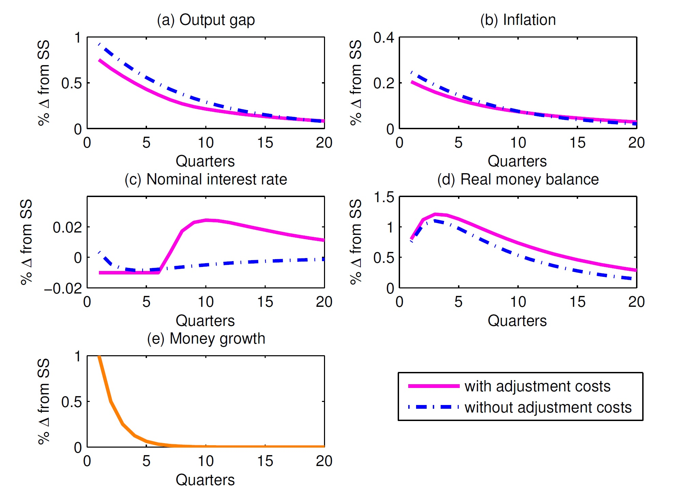

   **Fig. 4**:  Impulse responses to a positive money growth shock with the non-negativity constraint on the nominal interest rate when  :math:`\alpha= \delta =3`. Solid lines: with the adjustment cost; dashed lines: without the adjustment cost.

| 
| 
| 
| 
| 